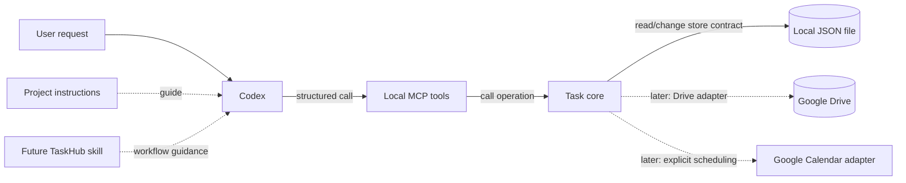

# Chapter 1: Understanding Codex Extensibility

Imagine asking Codex to manage a task. What tells it when to act, what performs the action, and what saves the result? Those are different jobs. This chapter maps them to familiar software boundaries, using TaskHub as a running example. TaskHub's local core, JSON storage, and MCP tools are implemented; cloud integrations and a reusable skill are planned.

## Reader goal

By the end, you should be able to decide whether a requirement belongs in project instructions, a skill, an MCP server, an application API, or persistent storage. You should also be able to explain where validation and authorization must happen when Codex can request a write.

## Prerequisites

You should be comfortable with functions, interfaces, and client–server requests. You do not need TaskHub code, a cloud account, an API key, or a running MCP server. A text editor is enough for the exercise.

## Concepts: five different jobs

Codex can interpret a request and select an action, but the components around it determine which actions exist and what they do. The distinction matters most when a request reads private data or changes durable state.

| Use | When it fits | What it does not provide |
| --- | --- | --- |
| **Project instructions** such as `AGENTS.md` | State repository conventions and development rules that apply across work in that project. | An executable operation or a security boundary. |
| **Skill** | Package a repeatable workflow, with instructions and optional resources, scripts, or templates. | Live application data or server-enforced permission. |
| **MCP server and tools** | Give Codex a defined way to read data or request controlled actions. | Your domain model, storage design, or authorization policy automatically. |
| **Application API** | Give clients a defined set of operations and let application code enforce rules. This may be an internal interface, HTTP API, or library API. | Persistence unless an implementation supplies it. |
| **Persistent storage** | Keep state across process restarts and, if designed for it, across devices. | Correct ownership, authorization, conflict resolution, or business rules by itself. |

Codex reads `AGENTS.md` as project guidance; see OpenAI's [Codex workflow example](https://developers.openai.com/cookbook/examples/codex/iterating-development-workflows-with-codex). A skill is a folder centered on `SKILL.md` that can guide a repeatable workflow, including when to call tools. An MCP server publishes tool definitions and runs calls using structured inputs. See the official [Skills](https://developers.openai.com/plugins/concepts/skills) and [MCP server](https://developers.openai.com/plugins/concepts/mcp-server) documentation. A [plugin](https://developers.openai.com/plugins/concepts/plugins) can package a skill, an MCP server, or both; you do not need one for this chapter.

An MCP tool is one interface to a capability. It can call an application operation such as `createTask`; that operation can use a storage adapter, which may call a provider API. Each interface has a different caller and responsibility. Storage keeps the resulting data after the process exits.

### Rules and authorization belong at executable boundaries

Suppose a user says, “We should remember to renew the certificate next month.” That is a discussion, not an explicit request to create a task. TaskHub's project rule and `create_task` tool description tell Codex to wait for a clear request. A future skill could reinforce that workflow. A local Codex check found that discussion of a tutorial example did not create a task. The current tool accepts a title without evidence of the original user request, however, so a direct caller can invoke it without proving intent. TaskHub still needs an enforceable intent or confirmation design if that rule must hold for every caller. The core validates task fields; it does not authenticate users.

Likewise, a due date does not authorize a Calendar event or notification. Scheduling needs its own explicit request. If tasks are shared, the server must authenticate the caller and check access to the relevant account or task on every operation. Instructions to Codex cannot establish identity or stop another client from calling an API. Official guidance says to [enforce authorization in the MCP server](https://developers.openai.com/plugins/build/mcp-server), not rely on the model to decide who has access. The [authentication guide](https://developers.openai.com/plugins/build/auth) describes patterns for protected MCP servers.

## Example architecture: TaskHub's local flow and planned integrations

TaskHub has implemented local task operations through an MCP server and a JSON file. The solid arrows show that local path, verified by automated tests and a manual Codex workflow. Dashed arrows to the future skill, Drive, and Calendar show planned components; the diagram does not claim cloud or shared-account behavior.

The task core owns task identity, fields, and create, list, update, and complete behavior. The MCP server exposes those operations to Codex, and the JSON adapter persists them locally. Tests covered task operations, validation, and data surviving an MCP server restart. A manual local Codex check covered explicit create, list, update, and complete requests. A future skill could guide use of the tools. A Drive adapter would add authentication, file format, and concurrent edit questions before shared writes. See the [TaskHub architecture overview](../architecture/overview.md), [local implementation decision](../decisions/0002-local-json-and-mcp.md), [development journal](../development-journal.md), and [roadmap](../roadmap.md).

This arrangement also lets another interface use the same task rules. A web dashboard should call the application contract rather than reimplementing the meaning of “complete” or the conditions for creating a task. In any project, place domain rules where every client passes through them, and put provider-specific behavior behind an adapter.

## Hands-on exercise: choose the right boundary

You need only a text editor. Imagine a note app that Codex can use. Read these two requests:

- “I might want to save this later.”
- “Save this note now: renew the certificate.”

For each request, decide whether Codex should call an `add_note` tool. Then match each part of the note app to the five choices in the decision table. Compare your answer with this worked result:

| Choice | Role in the note app |
| --- | --- |
| Project instructions | Tell Codex to call `add_note` only after an explicit save request. |
| Skill | Optional: guide a repeatable note workflow if it becomes useful. |
| MCP server | Expose `add_note` and pass its request to the application. |
| Application API | Validate the write request and apply the note app's rules. |
| Persistent storage | Keep saved notes after the app closes. |

The first request should not call `add_note`; the second may. The worked result is a design sketch, not a working app. Before building it, you would still need to decide how the write path checks intent or confirmation and, for private notes, how the server verifies the caller's access. A direct caller must face the same application and access checks as Codex.

## Limitations and verification still needed

This chapter explains boundaries rather than walking through the working local tools. Their implementation is in development commit `29a1fea`; a reusable skill, Drive adapter, and cross-device workflow are not implemented. The [development journal](../development-journal.md) records the local verification.

The local tests and Codex check do not prove that every caller has explicit user intent: `create_task` relies on Codex following guidance. The local MCP server does not authenticate or authorize users, and the JSON store coordinates writes only within one store instance. Drive access needs separate authentication, authorization, file-format, and concurrent-edit verification. A local test cannot establish cross-device behavior.

Official product and protocol details can change. Recheck the linked OpenAI documentation when implementing or publishing the hands-on integration chapters.

## Next steps

The next chapter introduces TaskHub's scope and repository rules. Later chapters examine the implemented core, JSON storage, and MCP tools before adding a reusable skill. The distinction in this chapter will help you judge each implementation choice: what guides Codex, what performs the action, and what enforces the rule?
