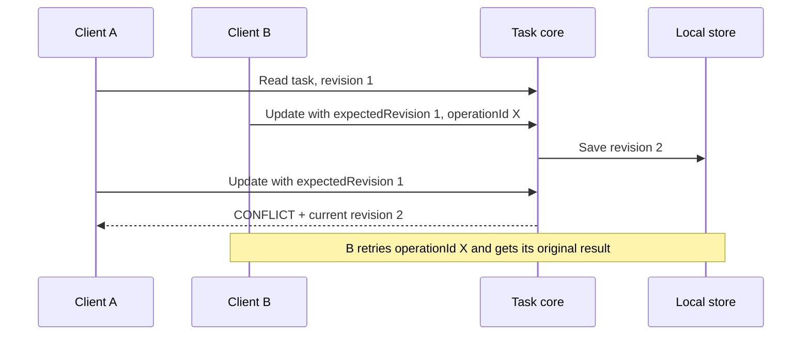

# Chapter 3: Building Reliable MCP Tools: Revisions, Idempotency, and Recovery

Chapter 2 built a local task manager and exposed four operations through MCP. That first version worked for a single local workflow, but a successful tool call was not the only outcome to consider. What if two writers update the same task? What if a save succeeds but its response is lost? What if the file is damaged?

This chapter compares [Milestone 1, `29a1fea`](02-building-your-first-mcp-server.md) with **Milestone 2, `1ee220cfa814ed8c0bb3c25927f1e367aaa0830f`**. All Milestone 2 behavior described here is local. The [development journal](../development-journal.md#2026-11-07--reliable-local-write-contract-verified-locally) records its verification; `git show 1ee220c` opens the exact commit in a TaskHub checkout.

## Reader goal

You will learn to recognize lost updates, duplicate retries, invalid stored data, and uncertain save outcomes. You will see how task revisions, stable operation IDs, a versioned file format, structured errors, and a local backup address those problems. The goal is to understand and reproduce the Milestone 2 contract, not to mistake local protection for cross-device synchronization.

## Prerequisites

Complete [Chapter 2](02-building-your-first-mcp-server.md), or read its core, JSON adapter, and MCP server sections. Use Node.js 20 or newer, npm, Git, and a TaskHub checkout containing commits `29a1fea` and `1ee220c`. The commands below work in PowerShell, Bash, or zsh from the repository root. Run tests against ignored fixture data, not your personal `.taskhub/tasks.json`.

To see the exact change set:

```text
git diff --stat 29a1fea 1ee220c -- packages/core integrations/codex tests
git show 1ee220c:docs/decisions/0003-revisioned-task-writes.md
```

These are shell commands; the `text` fence avoids implying they use a particular shell. The executable source at `1ee220c` is the reference when an excerpt omits surrounding code.

## Why Milestone 1 needed another pass

| Milestone 1 behavior | Failure mode | Milestone 2 response |
| --- | --- | --- |
| A task had no revision. | A stale client could overwrite a newer edit. | `update` and `complete` compare `expectedRevision` with the current task. |
| `create` had no operation ID. | Retrying after a lost response could create a second task. | Every write has a stable UUID and a durable operation ledger. |
| The file contained only `version: 1` and `tasks`. | A newer reader needed a safe path from old data. | Read version 1 in memory; migrate on the first successful write. |
| The store checked the top-level version and task array. | A malformed task could reach the core. | Validate task fields, metadata, and operation records on read. |
| The MCP adapter returned plain text errors. | A caller could not reliably distinguish conflict from bad input. | Return a code and details in `structuredContent` and JSON text. |
| Writes were serialized within one store instance. | Another process could write the same file at the same time. | An exclusive local `.lock` file rejects overlapping writes. |
| A rename replaced the primary file without a backup. | Damage or a missing primary could look like lost data. | Keep the previous valid file as `.bak` and require manual recovery. |

The two most important races are different:



The stale edit needs a **revision check**. A repeated request after an uncertain response needs an **idempotency key**. One mechanism does not replace the other.

Milestone 1's `create` accepted only task fields, so a second call with the same title was another create request. Milestone 2 changes the call to `create({ operationId, ...input })` and stores the result under that ID. Compare the full versions with:

```text
git diff 29a1fea 1ee220c -- packages/core/tasks.js
```

## Task revisions and optimistic concurrency

Milestone 2 adds a positive `revision` to each task. A new task starts at 1. An update increments it, as does the first completion. A caller lists tasks to obtain the current revision, then supplies `expectedRevision` when updating or completing. The user does not need to know the number.

This is the exact conflict check in `packages/core/tasks.js` at `1ee220c`:

```javascript
function findTask(doc, id, expectedRevision) {
  const index = doc.tasks.findIndex(task => task.id === id);
  if (index < 0) throw new TaskHubError('NOT_FOUND', 'Task not found');
  const current = doc.tasks[index];
  if (current.revision !== expectedRevision) throw new TaskHubError('CONFLICT', 'Task changed since it was read', { current });
  return index;
}
```

The check and write run inside one store transaction. On a conflict, no task update is saved and the error includes the current task for review. A client should explain the difference before attempting a new edit. The local Codex tool instructions say to list first and ask before retrying a conflict.

## Stable operation IDs and idempotent writes

Each new write now carries a caller-generated UUID `operationId`. Keep that ID when retrying the **same** operation; generate a new one for a different operation. The core normalizes arguments, serializes the operation kind and arguments as a comparison string, and checks the persisted ledger before applying it:

```javascript
const prior = doc.operations[operationId];
if (prior) {
  if (prior.signature !== signature) throw new TaskHubError('OPERATION_ID_REUSED', 'Operation ID was used with different arguments');
  return { changed: false, result: prior.result };
}
const result = apply(doc);
doc.storeRevision++;
doc.operations[operationId] = { signature, result };
return { changed: true, result };
```

This excerpt is from `TaskHub.write` at `1ee220c`. Reusing the ID with the same normalized arguments returns the original result, even after a server restart. Reusing it for different arguments returns `OPERATION_ID_REUSED`. The ledger grows with each distinct write; Milestone 2 does not define a pruning policy.

A failed rename can make the result uncertain: the file may or may not contain the write. The core looks up the operation ID after `OUTCOME_UNKNOWN`. If it finds the matching persisted signature, it returns that result. Otherwise it preserves the error so the caller can retry with the **same ID**, rather than inventing another create request. The test suite covers both branches with a test store.

## Version 2 data and migration

The local file changes from `{ "version": 1, "tasks": [...] }` to this shape:

```json
{
  "version": 2,
  "storeRevision": 1,
  "tasks": ["task records, each with a revision"],
  "operations": { "operation UUID": { "signature": "...", "result": {} } }
}
```

This is a shape illustration, not a valid file to paste into TaskHub. The actual file contains complete task and operation records. `validateDocument` reads a valid version 1 file into a version 2 **in-memory** shape and gives its tasks revision 1. Reading does not rewrite the file. The first confirmed write saves version 2 and keeps the former version 1 file as `.bak`. Validation and conflict failures leave version 1 untouched; if a save reports `OUTCOME_UNKNOWN`, inspect its operation result rather than assuming the file was or was not migrated. The test named `version 1 is read and migrated on first successful write, preserving fields` checks the original ID and timestamp and the backup's version.

`storeRevision` records each distinct successful write to the file. It is not the same as a task's revision: updating one task changes that task's revision, while a write to any task changes `storeRevision`.

## Validate inputs and data already on disk

Milestone 1 validated some tool inputs and task fields. Milestone 2 places application validation in `packages/core/validation.js`, so the core and MCP adapter share error codes. The exact normalization entry points are:

```javascript
export function normalizeCreate(input) {
  only(input, ['title', 'notes', 'dueDate']);
  return { title: title(input.title), notes: notes(input.notes ?? ''), dueDate: dueDate(input.dueDate ?? null) };
}
export function normalizeUpdate(input) {
  only(input, ['title', 'notes', 'dueDate']);
  const out = {};
  if (Object.hasOwn(input, 'title')) out.title = title(input.title);
  if (Object.hasOwn(input, 'notes')) out.notes = notes(input.notes);
  if (Object.hasOwn(input, 'dueDate')) out.dueDate = dueDate(input.dueDate);
  if (!Object.keys(out).length) throw new TaskHubError('INVALID_INPUT', 'Provide at least one field to update');
  return out;
}
```

Titles must be nonempty and at most 200 characters; notes can be at most 10,000 characters; due dates must be real `YYYY-MM-DD` dates or `null`. UUIDs and positive expected revisions are checked in the core. The MCP adapter deliberately accepts broad input values and passes them to that shared validation. Requests that reach the core receive the same application error shape; errors rejected by the MCP SDK before the handler runs may differ.

The file is untrusted input too. `JsonFileStore.read()` calls `validateDocument` before returning records. That function checks version, task IDs and fields, timestamps, revisions, metadata, and operation records. Bad JSON yields `DATA_CORRUPT`; an unsupported format yields `UNSUPPORTED_VERSION`. Neither becomes an empty task list.

For example, the stored-task check rejects missing fields and duplicate IDs before returning a task:

```javascript
const id = uuid(task.id, 'id');
if (id[14] !== '4') throw new Error('task ID must be UUID v4');
if (ids.has(id)) throw new Error('duplicate ID');
ids.add(id);
const fields = normalizeCreate({ title: task.title, notes: task.notes, dueDate: task.dueDate });
if (fields.title !== task.title || fields.notes !== task.notes ||
    (task.status !== 'open' && task.status !== 'completed')) throw new Error('invalid task');
```

This is an exact excerpt from `validateDocument`; the enclosing function converts these failures to `DATA_CORRUPT`.

## Structured MCP errors

The MCP adapter now returns a consistent envelope. This exact excerpt comes from `integrations/codex/server.js` at `1ee220c`:

```javascript
function response(body, isError = false) {
  return { isError, content: [{ type: 'text', text: JSON.stringify(body) }], structuredContent: body };
}
function handler(operation) {
  return async input => {
    try { return response({ ok: true, data: await operation(input) }); }
    catch (error) {
      const safe = error instanceof TaskHubError ? error :
        new TaskHubError('STORAGE_ERROR', 'Task operation failed');
      return response({ ok: false, error: { code: safe.code, message: safe.message, ...safe.details } }, true);
    }
  };
}
```

For example, a conflict produces `isError: true` and a body with `ok: false`, `error.code: "CONFLICT"`, and `error.current`. Text content carries the same JSON for clients that read text results. Unexpected exceptions become a generic `STORAGE_ERROR` rather than exposing an internal stack trace. [OpenAI's MCP server guidance](https://developers.openai.com/plugins/build/mcp-server) discusses structured and model-readable results; TaskHub's codes are application-specific, not MCP protocol error codes.

## Local locking, backup, and recovery

Inside `JsonFileStore.transact`, Milestone 2 creates the lock file exclusively:

```javascript
const lockPath = this.path + '.lock';
let lock;
try { lock = await open(lockPath, 'wx', 0o600); }
catch (error) {
  if (error.code === 'EEXIST') throw new TaskHubError('STORE_LOCKED', 'Task data is in use; retry later or inspect the stale lock');
  throw error;
}
```

A second cooperating local process that encounters the lock receives `STORE_LOCKED`. Writes within one process are also queued. The adapter writes and syncs a temporary file, copies the previous valid primary to `.bak`, then renames the temporary file to the primary. A lock left by a crash is **not** deleted automatically. Inspect the process and files before deciding it is stale. The automated test creates an existing lock file; it does not run two writer processes at once.

If the primary file is corrupt, reads fail instead of returning `[]`. If it is missing while `.bak` exists, reads return `RECOVERY_REQUIRED` instead of starting an empty store. `readBackup()` validates and returns the backup for inspection. The implementation does not automatically restore it; doing so could discard a newer valid change. Avoid editing or deleting your personal task file while following this section.

## Hands-on: reproduce and test the milestone

In a clean **TaskHub checkout**, use the exact milestone. Do not switch a checkout that contains uncommitted work:

```text
git switch --detach 1ee220c
npm ci
npm test
node --check integrations/codex/server.js
```

The code excerpts above are exact sections of that commit; the checkout supplies their imports, surrounding methods, and test fixtures. `npm test` runs ten tests. Among them:

| Test name in the milestone | What it demonstrates |
| --- | --- |
| `every write is idempotent and rejects operation ID reuse with different arguments` | Same-ID retries return the saved result; changed arguments are rejected. |
| `stale revisions conflict without overwriting and missing IDs fail` | A stale edit returns `CONFLICT` and leaves the newer title intact. |
| `version 1 is read and migrated on first successful write, preserving fields` | Read leaves version 1 on disk; a write creates version 2 and a version 1 backup. |
| `corrupt data is never replaced with an empty list; backup remains inspectable` | Corrupt primary data blocks writes and leaves a readable backup. |
| `validation, lock conflict, and persistence failure` | Bad input and an existing lock fail; a backup-path failure leaves the saved task unchanged. |
| `uncertain outcome resolves from persisted operation or remains explicit` | A matching ledger result resolves ambiguity; otherwise `OUTCOME_UNKNOWN` remains visible. |
| `MCP server lists tools and persists a task across process restarts` | MCP discovery, retry after restart, structured conflict, missing ID, and invalid input. |

The [development journal](../development-journal.md#2026-11-07--reliable-local-write-contract-verified-locally) records **10 passing tests** and one isolated fresh Codex session that created, listed, updated, and completed a test task. In that session, discussing a hypothetical example did not create another task. An earlier fresh session with `approval: never` could list but did not create a task because the write was rejected; it is not evidence of a storage failure.

## Limitations

The local lock only coordinates processes that use this file path and honor the lock. It does not provide cloud conditional writes, account ownership, permissions, or cross-device sync. Reading a Drive file and then uploading a replacement would still risk overwriting another device's work. A future Drive adapter needs an enforceable conditional-write contract and separate multi-account verification.

Stable operation IDs and revisions improve the write contract; they do not prove the user explicitly requested a task. Codex still relies on project and tool guidance for natural-language intent, and the local MCP server does not authenticate users. Keep the primary file and its `.bak` backup out of Git and protect the directory with suitable local permissions; a backup is another copy of private task data. Cloud writes must define and enforce authorization separately. A due date still does not create a Calendar event.

## Next steps

[Chapter 4](04-choosing-cloud-storage.md) explains the storage and OAuth architecture; [Chapter 5](05-integrating-google-drive.md) applies this write contract to a disposable Drive file. The local write contract does not replace authorization or user intent checks.

## Verified Against

- **Milestone 1:** `29a1fea36a45b352b136413c9eae3fbf58d9be6c`, the Chapter 2 local JSON and MCP implementation.
- **Milestone 2:** `1ee220cfa814ed8c0bb3c25927f1e367aaa0830f`, including [ADR 0003](../decisions/0003-revisioned-task-writes.md), the core, store, validation module, MCP adapter, and tests.
- **Checks for this chapter:** six source excerpts matched `1ee220c`; the application and test files matched that commit at the time of this review, and `npm test` passed 10 tests with 0 failures. `node --check integrations/codex/server.js` passed, and the Mermaid diagram parsed successfully. The manual Codex session is documented in the journal and was not repeated for this chapter. Cloud, cross-device, and multi-account behavior were unverified at Milestone 2; Chapter 5 covers the later one-computer Drive checks.
