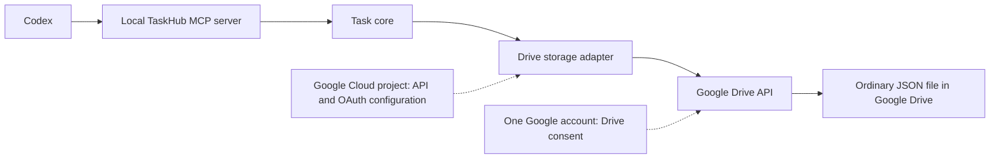

# Chapter 4: Choosing Cloud Storage for a Codex MCP Integration

Chapters 2 and 3 built a reliable **local** task manager. A local JSON file does not by itself make the same tasks available to Codex installations on different computers. This chapter explains why TaskHub added Google Drive storage in Milestone 3.

## Reader goal

Understand what Google Drive stores, what Google Cloud configures, how a local MCP server reaches a file, and what the choice is likely to cost. You should be able to distinguish the implemented one-computer integration from the untested second-computer setup.

## Prerequisites

Read [Chapter 3](03-building-reliable-mcp-tools.md) for the local write contract. You need no Google Cloud project to follow this chapter.

## Concepts: Drive, Cloud, and accounts

| Name | Role in this design |
| --- | --- |
| [Google Drive](https://drive.google.com/) | The user's file storage and sharing service. TaskHub's Drive mode uses an ordinary JSON file here. |
| [Google Cloud Console](https://console.cloud.google.com/) | The developer's control panel for a Cloud project, enabled APIs, OAuth consent, and application credentials. It does not contain the task file. |
| Google account | The identity used to sign in to both services. You can use an existing account; creating a Cloud project does not create a second Google identity. |
| Cloud project | A container for API configuration and usage quotas, not a Drive folder. Enabling the Drive API here lets an application request access to Drive. |
| OAuth client ID | An identifier for the application in that Cloud project, not a Google username or password. The Drive account separately grants the application access. |

For the [Chapter 5 walkthrough](05-integrating-google-drive.md), use **one personal Google account** for Drive storage, **one Cloud project**, **one Desktop OAuth client**, and **one Drive JSON file**. Each Codex installation can be configured to use that file through its local MCP server after the Drive account authorizes access. A ChatGPT/Codex login is independent of the Google account used for Drive; different Codex logins do not require different Drive accounts. Only one-computer behavior has been verified.

The Milestone 3 TaskHub integration uses a **Desktop application OAuth client**. The local program opens a browser for consent and receives the response through a local redirect. It does not need a separately hosted application server. Google hosts the Drive API and OAuth service; TaskHub's MCP server runs on the user's computer. A desktop client ID is public application identification, while downloaded client configuration and especially refresh tokens still deserve careful local handling. Do not commit credentials, tokens, or private task data. See Google's [desktop OAuth guide](https://developers.google.com/identity/protocols/oauth2/native-app) and [Drive scope guide](https://developers.google.com/workspace/drive/api/guides/api-specific-auth).

## Example architecture

The task core owns task rules; the adapter translates reads and writes to Drive API calls. The Cloud project supplies API configuration and OAuth client credentials, while Drive holds the data. This design needs no hosted TaskHub server, Google Cloud database, or virtual machine. A Google Drive folder is optional organization for the file; it is unrelated to the Cloud project.

**Implementation status:** TaskHub's Milestone 2 core, local JSON adapter, and MCP tools are implemented. Milestone 3, commit `bd13797`, added the Drive adapter and verified it with a **disposable** Drive JSON file on one computer. An earlier isolated connectivity probe used two accounts on that computer; the [development journal](../development-journal.md) records both checks. TaskHub's real local task data has not been migrated, and cross-device synchronization has not been verified.

## Expected cost and limits

For a small personal application, the expected **incremental** cost is approximately **$0**, assuming the account already has available Drive storage, usage stays within standard API limits, and the project uses no other billable Cloud services. This is an estimate, not a promise of permanent free service.

As checked November 10, 2026, Google says standard [Drive API usage has no additional charge](https://developers.google.com/workspace/drive/api/guides/limits). Its published limits for new projects include **1,000,000 quota units per minute per project**, **325,000 per minute per user per project**, and **1 TB per day per project of egress**. A separate published daily billing threshold is **400,000,000 quota units per project**. Quota units are weighted API usage, not simply request counts. Google's page says charges for exceeding request limits are planned later in 2026, with full billing details and at least 90 days' notice before changes; a billing account may be needed for paid overage or quota increases. Check the live quota page and your project's settings before relying on these figures. Older active projects can have different quotas. [Source: Drive API usage limits](https://developers.google.com/workspace/drive/api/guides/limits).

Drive **storage** is a different limit. A personal Google account includes up to **15 GB shared across Drive, Gmail, and Photos**; a Workspace account or paid plan can have a different allocation. A normal Drive file counts against its owner's storage, not the recipient's. More storage may require a paid plan. [Source: Google Drive storage help](https://support.google.com/drive/answer/9312312?hl=en).

Enabling the Drive API in a Cloud project is different from provisioning a paid server or database. Some Google Cloud products require billing, and future Drive API overage pricing may change; inspect the [Drive API pricing and quotas](https://developers.google.com/workspace/drive/api/guides/limits) and [Cloud Billing guidance](https://docs.cloud.google.com/billing/docs/how-to/manage-billing-account) for the specific project before enabling other services.

## Hands-on exercise

Without creating any project, draw two boxes labeled **Cloud project** and **Drive file**. Put “Drive API enabled” and “Desktop OAuth client” in the first; put “taskhub-drive-integration-test.json” in the second. Draw an arrow labeled “authorized Drive API request” between them. If you put the JSON file inside the Cloud project, move it: the project configures access, while Drive stores the file.

## Limitations

Chapter 3's local lock protects one computer. The implemented Drive adapter checks the file version before upload but cannot prevent a simultaneous cross-device write after that check; the risk of a lost update remains. OAuth scope and file permission limit what Google permits, but task creation and scheduling still require explicit user intent, and application code must enforce task rules and authorization. An External OAuth app in **Testing** receives Drive refresh tokens that generally expire after seven days; see [Google's OAuth guidance](https://developers.google.com/identity/protocols/oauth2#expiration).

### Optional: sharing with another Google account

Sharing a file in Drive and granting an application access to that file are separate. In Phase A, a second account could open an Editor-shared disposable file in Drive, but its initial `drive.file` API read returned 404. Selecting that same file through Google Picker resolved the API failure. This was tested with two accounts on **one computer**, not two devices. See [Chapter 5's optional advanced section](05-integrating-google-drive.md#optional-advanced-another-google-account) for the setup and [Google's scope guidance](https://developers.google.com/workspace/drive/api/guides/api-specific-auth). Work or school accounts may face [Workspace administrator restrictions](https://support.google.com/a/answer/7281227?hl=en).

## Next steps

[Chapter 5](05-integrating-google-drive.md) walks through the one-account Cloud Console and OAuth setup using Milestone 3's disposable file. Cross-account sharing and Picker troubleshooting are optional advanced material.
