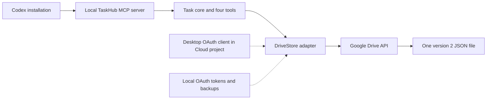

# Chapter 5: Integrating Google Drive with a Codex MCP Server

Chapter 4 chose an ordinary Drive JSON file for TaskHub. At Milestone 3, commit `bd137975bffd6d5885b6a25a771ca244b57d45e6`, the Drive adapter exists: the same four MCP tools can use local or Drive storage. Run `git show bd13797` in a TaskHub checkout to inspect the exact milestone. This chapter builds a **disposable** Drive setup with one personal Google account. It does not migrate your real tasks.

## Reader goal

Connect a local TaskHub MCP server to one version 2 JSON file in Google Drive; understand how OAuth, validation, version checks, backups, and errors protect that file. The intended later use is one file across multiple Codex installations, even if those installations use different ChatGPT/Codex logins. Each installation authenticates separately to the **same personal Google account** for storage. No Drive file sharing with another Google account is needed for this path. The second-computer path remains untested.

## Prerequisites

- Node.js 20 or newer, npm, Git, and Codex CLI on the computer you will test. Start from a TaskHub checkout containing `bd13797`; run `npm ci` from the repository root to install the committed dependencies.
- One personal Google account with available Drive storage. You can use that same account in Google Cloud Console. Your ChatGPT/Codex account is independent of this Google account.
- A browser on the test computer. Keep all OAuth URLs and callback codes local; do not paste them into a chat.
- Finish [Chapter 3](03-building-reliable-mcp-tools.md) or understand version 2 task documents, revisions, and stable operation IDs.

These steps use PowerShell on Windows, matching the verified machine. The Node programs also use a local OAuth callback on macOS and Linux, but the complete setup was not tested there.

## Concepts: what lives where

Google Drive holds the JSON file; [Google Cloud Console](https://console.cloud.google.com/) holds the project, enabled APIs, consent configuration, and OAuth client. A Cloud project is not a Drive folder. The Desktop client identifies TaskHub as an application; it is not your Google password. The local OAuth flow opens your browser, receives a code on a loopback address, and obtains tokens. No hosted TaskHub server, database, or virtual machine is needed. [Google's desktop OAuth guide](https://developers.google.com/identity/protocols/oauth2/native-app) explains this flow.

For a small personal app, expected incremental cost is approximately **$0** if the account has available storage, API usage remains within standard limits, and no other billable Cloud services are enabled. Google's [Drive API limits and pricing](https://developers.google.com/workspace/drive/api/guides/limits) say standard usage has no additional charge but describe quotas and possible later overage charges. Drive storage is separate: a personal account includes up to [15 GB shared with Gmail and Photos](https://support.google.com/drive/answer/9312312?hl=en). Check current pricing before relying on this estimate.



The task core still owns validation and operation IDs. The adapter owns Drive reads, uploads, version checks, and local backups. `TASKHUB_STORAGE` chooses the adapter at server startup; the [source selection](../../integrations/codex/server.js) is short:

```javascript
const mode = process.env.TASKHUB_STORAGE ?? 'local';
if (mode !== 'local' && mode !== 'drive') throw new TaskHubError('INVALID_CONFIG', 'TASKHUB_STORAGE must be local or drive');
const store = mode === 'local'
  ? new JsonFileStore(resolve(process.env.TASKHUB_DATA_FILE ?? '.taskhub/tasks.json'))
  : new DriveStore({
    fileId: process.env.TASKHUB_DRIVE_FILE_ID,
    backupDir,
    tokenProvider: new DriveTokenProvider({
      credentialsFile,
      stateFile,
      account: process.env.TASKHUB_DRIVE_ACCOUNT
    })
  });
```

The snippet omits imports and path setup. Use the linked file for runnable source. Local mode remains the default; Drive mode **never** silently falls back to local storage.

## Hands-on: one account, one file

### 1. Configure Google Cloud and OAuth

Sign in to [Google Cloud Console](https://console.cloud.google.com/) with your existing personal Google account. Create one project for this disposable exercise, enable **Google Drive API** and **Google Picker API**, and configure the Google Auth platform's consent screen. Select an **External** audience, keep the app in **Testing**, and add your personal account as a test user. Under Data Access, request only `https://www.googleapis.com/auth/drive.file`. Create one OAuth client with application type **Desktop app**. Download its JSON credentials. Google's [Drive Node quickstart](https://developers.google.com/workspace/drive/api/quickstart/nodejs) shows the current Console flow; the [`drive.file` documentation](https://developers.google.com/workspace/drive/api/guides/api-specific-auth) explains the narrow scope.

Save the download as `%LOCALAPPDATA%\TaskHub\drive-poc\oauth-client.json`, **outside the repository**. Keep the whole `drive-poc` directory private. The OAuth client JSON is application configuration, while `poc-state.json`, created by the next command, holds access and refresh tokens. Never commit either file, backup files, or task data. An External app in Testing generally issues Drive refresh tokens that [expire after seven days](https://developers.google.com/identity/protocols/oauth2#expiration); reauthorize if needed.

### 2. Authorize and create a disposable task file

From the repository root in PowerShell:

```powershell
$env:TASKHUB_DRIVE_ACCOUNT = 'personal'
node .\integrations\drive\authorize.js auth
node .\experiments\drive-connectivity\drive-poc.mjs create-store personal
```

Open the URL printed by `auth` in your local browser, choose the intended personal Google account, and complete consent. The second command creates an **empty** `taskhub-drive-integration-test.json` in that account. Its output has the shape `{"created":true,"fileId":"...","name":"taskhub-drive-integration-test.json","version":"..."}`. Copy the actual `fileId` value into your local shell. It does not read or copy `.taskhub/tasks.json`.

```powershell
$env:TASKHUB_DRIVE_FILE_ID = '<FILE_ID_FROM_CREATE_STORE>'
node .\integrations\drive\authorize.js pick
```

Open the printed URL and select that same JSON file. Picker makes the selected file available to this OAuth client under `drive.file`. `auth` and `pick` use a local browser callback and write token state outside Git. [TaskHub's setup command](../../integrations/drive/authorize.js) implements PKCE and stores the token state; do not send its printed URL or callback code to anyone.

`create-store` refuses to create a second disposable file when one is already recorded in its local state. Save the printed file ID with your private setup notes so you can reuse it. The probe also records it in `poc-state.json`, which contains tokens and must remain private. The [probe source](../../experiments/drive-connectivity/drive-poc.mjs) creates the exact initial document:

```javascript
{ version: 2, storeRevision: 0, tasks: [], operations: {} }
```

### 3. Register an isolated Drive-mode MCP server

Keep any existing local TaskHub registration intact. Use absolute paths from the repository root:

```powershell
$taskhubRoot = (Get-Location).Path
$taskhubServer = Join-Path $taskhubRoot 'integrations\codex\server.js'
$driveHome = Join-Path $env:LOCALAPPDATA 'TaskHub\drive-poc'
$credentials = Join-Path $driveHome 'oauth-client.json'
$tokenState = Join-Path $driveHome 'poc-state.json'
$backups = Join-Path $env:LOCALAPPDATA 'TaskHub\drive-backups'
codex mcp add taskhub_drive --env 'TASKHUB_STORAGE=drive' --env "TASKHUB_DRIVE_FILE_ID=$env:TASKHUB_DRIVE_FILE_ID" --env 'TASKHUB_DRIVE_ACCOUNT=personal' --env "TASKHUB_DRIVE_CREDENTIALS_FILE=$credentials" --env "TASKHUB_DRIVE_STATE_FILE=$tokenState" --env "TASKHUB_DRIVE_BACKUP_DIR=$backups" -- node $taskhubServer
codex mcp list
```

The registered environment selects Drive mode. `TASKHUB_DATA_FILE` is ignored in that mode. Restart Codex after changing an MCP registration. Check `codex mcp add --help` if your installed CLI differs; the [official Codex MCP guide](https://developers.openai.com/learn/docs-mcp) documents registration. The commands assume `LOCALAPPDATA` is set; use explicit absolute paths if it is not.

### 4. Test through natural language

In a new Codex session using `taskhub_drive`, ask:

1. “List my TaskHub tasks in the Drive test file.” Expect an empty list in a new file.
2. “Create a disposable task called ‘Verify Drive tutorial’.” Expect one open task. Codex should generate an operation ID.
3. “Change its notes to ‘Verified through Codex.’” Expect an updated task revision; Codex should list first to obtain the current revision.
4. “Complete that task.” Expect a completed task, again using the current revision.
5. “For an example only, suppose I might buy groceries someday.” Expect **no** new task. List once more to confirm.

The Milestone 3 smoke test followed this pattern on **one computer** with a disposable file. It verified Codex generated operation IDs and supplied current revisions without asking the user. It did not test a second computer. Never use an example prompt to authorize creation of a real task.

## What the adapter checks

Every operation reads Drive metadata and the JSON content. The [DriveStore](../../packages/core/drive-store.js) requires the selected file to be an untrashed `application/json` file, and `validateDocument` requires a valid TaskHub version 2 document. Invalid or unreadable data stops the operation. The core's task validation and operation ledger still govern task writes.

Before a changed write, DriveStore saves a validated local copy of the previous document and syncs it to disk. It then fetches Drive metadata again and compares `version` before uploading:

```javascript
await this.backup(previous, version);
const current = await this.metadata();
if (current.version !== version) throw new TaskHubError('DRIVE_CHANGED', 'Drive file changed before upload; reload tasks',
  { expectedVersion: version, currentVersion: current.version });
await this.request(`upload/drive/v3/files/${encodeURIComponent(this.fileId)}?uploadType=media`, {
  method: 'PATCH', body: JSON.stringify(document), contentType: 'application/json', writing: true
});
```

The check catches a change seen **before** upload. It is not an atomic cloud precondition: two computers can both pass the check, and a later upload can overwrite the earlier one. There is no shared cloud lock, offline queue, or automatic merge. A metadata-only Drive change can also cause `DRIVE_CHANGED`; list again before retrying. Local backups are created for changed writes, contain private task data, and are not automatically pruned. See the [setup and recovery guide](../architecture/google-drive-storage.md) for manual backup validation and restore.

If a write times out or its response cannot be trusted, the adapter returns `OUTCOME_UNKNOWN`. The core checks the durable operation ID to see whether the write landed. Do not invent a new operation ID for an uncertain retry. MCP tools return structured errors rather than silently switching stores.

## Troubleshooting

| Result | Check |
| --- | --- |
| `UNAUTHORIZED` | Confirm the browser used the intended Google account. If authorization expired or was revoked, rerun `node .\integrations\drive\authorize.js auth`, then select the file again if needed. |
| `DRIVE_FILE_UNAVAILABLE` (Drive API 404) | Confirm `TASKHUB_DRIVE_FILE_ID` is the file ID printed by `create-store`, then rerun `node .\integrations\drive\authorize.js pick` and select that file. This can also occur in the optional second-account path when Drive sharing is present but app access is not. |
| `FORBIDDEN` (Drive API 403) | Confirm the account and file permissions; a work account may also be restricted by its administrator. |
| `DRIVE_FILE_INVALID` or `DATA_CORRUPT` | Check that the selected file is the untrashed TaskHub JSON file and contains a valid version 2 document. Do not overwrite it with an empty file. |
| `BACKUP_FAILED` | Check the local backup directory and permissions. The upload was skipped. |
| `DRIVE_CHANGED` | List tasks again and inspect the current revision before retrying the intended edit. |
| `OUTCOME_UNKNOWN` | The core attempts to confirm the write by its operation ID. If it cannot, stop and inspect the Drive file and backups before retrying with the **same** ID; do not issue a new create request. |

The [storage setup and recovery guide](../architecture/google-drive-storage.md) describes manual backup validation and restore. The app does not restore backups automatically.

## Optional advanced: another Google account

The main setup needs no file sharing or second Google account. Phase A and the disposable MCP protocol test also used a work account on **the same computer**. The personal account shared the test file as Editor. The work account could open it in Drive, but its first `drive.file` API read returned **404**. Selecting that shared file through Google Picker granted this app per-file access and resolved the read. Drive sharing permission and OAuth per-file authorization are separate. If you add a second account, add it as an OAuth test user, authorize it into the `work` token slot, and select the shared file with Picker. Work accounts may have [Workspace administrator restrictions](https://support.google.com/a/answer/7281227?hl=en). This is optional and does not establish cross-device behavior.

## Limitations and next steps

This chapter uses disposable data. **Real-task migration is deferred**; do not point Drive mode at the user's local `.taskhub/tasks.json` or copy its contents without a separate migration decision. **Second-computer operation is untested**, even though the design permits multiple Codex installations and different ChatGPT/Codex logins to authorize the same Google account. **Simultaneous-write loss remains an accepted risk** under the current best-effort version check. Read [Chapter 4](04-choosing-cloud-storage.md) for the storage choice and [Chapter 3](03-building-reliable-mcp-tools.md) for revisions and idempotency. Two-computer acceptance and stronger concurrency would require separate development and verification.

## Future Extensions

Google Calendar scheduling and notifications could be taught in a standalone **Additional Functions** tutorial. They are not part of this core series or Milestone 3. A due date in TaskHub remains task data; creating a Calendar event or notification requires a separate explicit user request and a verified integration.

## Verified Against

- Source: committed Milestone 3 `bd137975bffd6d5885b6a25a771ca244b57d45e6` (`git show bd13797`); relevant implementation and results are recorded in the [development journal](../development-journal.md) and [acceptance record](../architecture/milestone-3-acceptance.md). A Git remote is configured, but this review did not confirm that the commit is publicly accessible there.
- Documented Milestone 3 result: `npm test` passed **21/21**; changed JavaScript syntax checks and `git diff --check` passed. The mocked Drive adapter and token provider are covered by tests. The disposable MCP protocol harness exercised all four tools under both accounts on one computer. The later natural-language smoke test exercised create, list, update, and complete under the personal account on one computer.
- Not verified by Milestone 3: a second computer, simultaneous cloud writes, real-task migration, production OAuth publishing, or a guaranteed free long-term price.
